<!-- ════════════════════════════════════════════════════════════════
     Saif Ur Rehman Hashmi · GitHub Profile
     Theme: Obsidian & Gold  ·  custom animated SVGs live in /assets
     ════════════════════════════════════════════════════════════════ -->

  

  

  
  <!-- LinkedIn → replace YOUR-LINKEDIN-ID, then delete the two comment marks around this line
  
  -->
  
  

 

<!-- ─────────────────────────────── 01 · ABOUT ─────────────────────────────── -->
<picture>
  <source media="(prefers-color-scheme: light)" srcset="./assets/light/title-about.svg">
  
</picture>

<table>
<tr>
<td width="52%" valign="top">

I am a **Computer Science undergraduate** student at the
**University of Management & Technology (UMT), Lahore**, focused on building
software that is reliable, maintainable and purposeful.

My work spans several layers of computing: systems-level programming in
**C++ and x86 Assembly**, full-stack web applications backed by relational
databases, and process automation with **n8n**. I take ownership of a problem
from first principles through to a finished, working product.

My long-term direction is **Artificial Intelligence and Machine Learning**.
I am deliberately building a strong software-engineering foundation first,
while advancing my expertise in **Python for data science and machine learning**.

◆ &nbsp;<b>FOCUS</b> &nbsp;Full-Stack Development · Workflow Automation · Machine Learning 
◆ &nbsp;<b>OPEN TO</b> &nbsp;Collaborations on web, automation and academic projects 

</td>
<td width="48%" valign="middle" align="center">
  
</td>
</tr>
</table>

 

<!-- ─────────────────────────────── 02 · TOOLKIT ─────────────────────────────── -->
<picture>
  <source media="(prefers-color-scheme: light)" srcset="./assets/light/title-toolkit.svg">
  
</picture>

◆ &nbsp;<b>LANGUAGES</b> &nbsp;◆

  

◆ &nbsp;<b>FULL-STACK DEVELOPMENT</b> &nbsp;◆

  

◆ &nbsp;<b>DATABASES</b> &nbsp;◆

   
  <b>Also familiar with</b> &nbsp;SQL &nbsp;·&nbsp; Microsoft SQL Server (SSMS)

◆ &nbsp;<b>TOOLS &amp; DEVOPS</b> &nbsp;◆

  
   
  <b>Also familiar with</b> &nbsp;Cisco Packet Tracer &nbsp;·&nbsp; VMware

 

<!-- ─────────────────────────────── 03 · SELECTED WORK ─────────────────────────────── -->
<picture>
  <source media="(prefers-color-scheme: light)" srcset="./assets/light/title-work.svg">
  
</picture>

  
  
  
  

 

<!-- ─────────────────────────────── 04 · ANALYTICS ─────────────────────────────── -->
<picture>
  <source media="(prefers-color-scheme: light)" srcset="./assets/light/title-analytics.svg">
  
</picture>

◆ &nbsp;<b>DEVELOPER OVERVIEW</b> &nbsp;◆

  

<table align="center">
  <tr>
    <td align="center" width="50%">
      ◆ &nbsp;<b>PERFORMANCE METRICS</b> &nbsp;◆ 
      
    </td>
    <td align="center" width="50%">
      ◆ &nbsp;<b>LANGUAGE PROFICIENCY</b> &nbsp;◆ 
      
    </td>
  </tr>
</table>

<table align="center">
  <tr>
    <td align="center">
      ◆ &nbsp;<b>PRODUCTIVITY PATTERN</b> &nbsp;◆ 
      
    </td>
    <td align="center">
      ◆ &nbsp;<b>CONSISTENCY</b> &nbsp;◆ 
      
    </td>
  </tr>
</table>

◆ &nbsp;<b>CONTRIBUTION ACTIVITY</b> &nbsp;◆

  

 

<!-- ─────────────────────────────── 05 · CONTRIBUTION TRAIL ─────────────────────────────── -->
<picture>
  <source media="(prefers-color-scheme: light)" srcset="./assets/light/title-trail.svg">
  
</picture>

  

 

  <picture>
    <source media="(prefers-color-scheme: light)" srcset="./assets/light/footer.svg">
    
  </picture>

